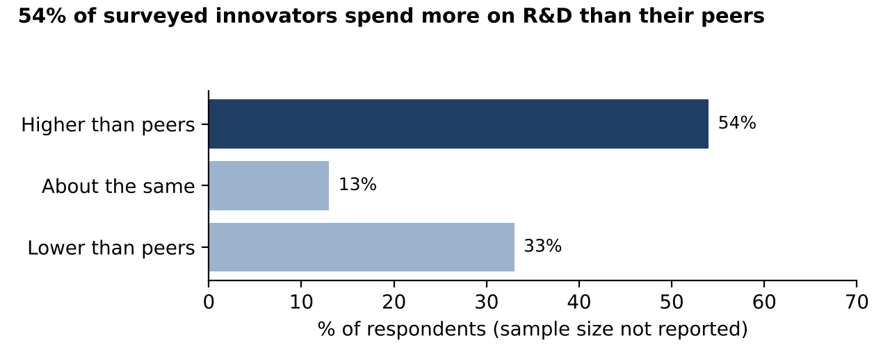
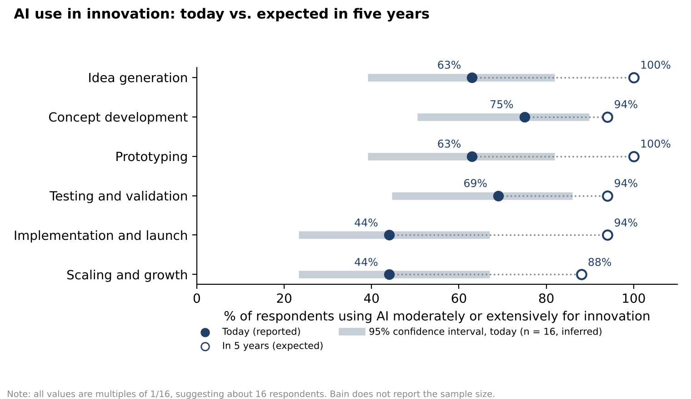
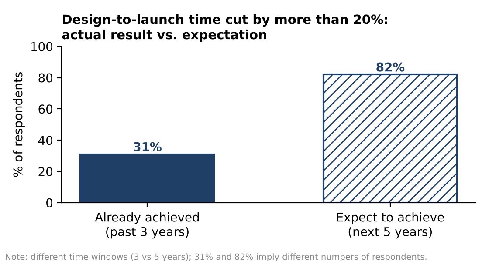

# ✍️ 我的写作区：COMP 1913 个人报告（2,000 词 · 12/4 截止 · 占 50%）

## 📄 完整初稿（11/5 · 正文约 1,980 词，不含小标题、图注和参考文献）

<a class="btn" href="/content/comp1913/files/COMP1913_Report_Draft.docx" download>⬇️ 报告完整版 Word（11/5：UOG x LSBF 封面 + 目录 + 正文 + Figure 1–3 + 参考文献 + AI 声明；网站版不含学号，带学号的 Final 版 Claude 直接发给你）</a>

> 结构：Executive Summary → 1 Background → 2 Evaluation of Visualisations（含 Figure 1–3）→ 3 Analytical Tools → 4 Data Integrity and Cognitive Bias → 5 Recommendations → List of References（3 篇）。
> ✅ 11/5 用户确认：老师 **Mr. Zhou Zhihao**；Module Code **COMP-1913-M04-2026-27 International Data Analytics**。
> ✅ 11/5：找到 brief、手册和模板（封面、AI 声明和 BUSI 1772 同一份）→ 加了封面（Module Code、老师、12/4 截止）和 AI 声明（放最后，如实写 AI 帮写中文样板、作图、改语法、核对数据）。手册确认 **12/4 截止**、2,000 词不含参考文献。
> ⬜ 可选改进：brief 要求“学术和业界来源”，现在 3 篇（1 业界 + 2 学术），可以再加 1–2 篇；brief 的结构把“认知偏差”放在“图表”前面，我们按 brief 的 5 个要求顺序写，也可以。

## ✅ 已完成：执行摘要英文（11/5，用户翻译 → Claude 改语法，约 125 词）

**Executive Summary**

This report evaluates Bain & Company's *Innovation Report 2025*. Based on a survey of 20 of the "most innovative companies", Bain's report offers valuable ideas on innovation and AI investment, but its evidence is weak. All 24 charts are donut charts, and none shows the sample size; some chart titles do not match the data, and expectations are mixed with actual results. Some questions were answered by only about 16 companies, so the margin of error is large. Bain's report may also reflect survivorship bias, confirmation bias and self-reporting, and it treats correlation as causation. This report recommends that executives use Bain's report as a starting point for discussion and test its claims with their own data first, and that Bain disclose its methods and improve its charts.

**改了什么**：Bain&Company 加空格；“figures”（插图）→ **charts**、circular graphs → **donut charts**（全文统一）；分号后的 Some、It 改小写；“and consider correlations as causality” 主语不清 → **it treats correlation as causation**；“It is also recommended that…” 被动句 → 合并成一句：recommends that executives… and that Bain…；validate it → **test its claims**；按字数删了几个词。

## 🀄 执行摘要中文样板（11/5，Claude 按你写好的 5 节整理；只总结、不加新内容）
> 先改成你自己的说法再翻译；翻译后约 120 词。放在报告最前面（第 1 节之前）。

**Executive Summary**

本报告评估贝恩咨询的《Innovation Report 2025》。该报告基于对 20 家“最具创新力公司”的调查，提出了关于创新和 AI 投入的有价值观点，但证据较弱。报告的 24 张图全部是环形图，没有一张写明样本量；部分图表标题和数据不一致，还把预期和实际结果混在一起。从数字推算，有些问题只有约 16 家公司回答，误差很大。报告还可能受到幸存者偏差、确认偏误和自我报告的影响，并把相关性当作因果。本报告建议高管把它当作讨论的起点，先用自己的数据验证；也建议 Bain 公布方法并改进图表。

## ✅ 已完成：第 5 节英文定稿（11/5，用户翻译 → Claude 改语法，约 224 词）

**5. Recommendations**

For executives considering investing more in innovation and AI, this report makes three recommendations. First, they should treat the conclusions of Bain's report as a starting point for discussion rather than as evidence for decisions, because the sample is small and includes only successful companies. Second, before using any figure, they should find out how many companies answered, what the original question wording was and who the respondents were. Third, they should distinguish between actual results and expectations: "100% use of AI in five years" is only the expectation of a small number of companies, not a signal that they must follow the trend. Executives should first run small pilots using their own company and industry data, and invest at scale only after the results have been proven.

For Bain, this report suggests two improvements. First, it should publish a methodology note, including the sample size, the number of respondents to each question, the original question wording and the respondents' job roles. Second, it should choose more suitable charts: replacing single-number donut charts with bar charts and dumbbell charts, separating actual data from expectations, showing confidence intervals, and providing interactive data that can be filtered by industry.

Overall, this report concludes that Bain's report is useful for starting a discussion, but should not be used directly as a basis for investment decisions.

**改了什么（主要的）**：⭐ “not a signal that **must follow the trend**” → not a signal that **they must follow** the trend（原句变成“信号必须跟风”）；“thought-provoking clues” → **a starting point for discussion**；“the original **text** of the question”（第三次了）→ **the original question wording**；the answerer → **the respondents**；method statement → **a methodology note**；**single digit** circular charts（= 个位数的圆形图）→ **single-number donut charts**；security 之类的词这次没有，很好；“this report **believes**”（报告不会“相信”）→ **this report concludes**；“not directly used as” 缺动词 → **should not be used directly as**；Firstly / Secondly → First / Second（全文统一）；每条建议加了主语 they / it，读起来更像建议。

**📏 字数**：第 1–5 节合计 276 + 825 + 202 + 345 + 224 = **1,872 词**，执行摘要约 120 词 → 全文约 1,990 词。

## 🀄 第 5 节中文定稿（11/5，收尾句是用户的，拿去翻译）
> ⚠️ 样板，先改成你自己的说法再翻译；**⬜ 那一句必须你自己写**。翻译后约 230 词。

**5. Recommendations**

对于考虑加大创新和 AI 投入的高管，本报告提出三条建议。第一，把 Bain 报告的结论当作值得思考的线索，而不是决策的证据，因为样本很小，而且只包括成功的公司。第二，在使用任何一个数字之前，先弄清楚有多少家公司回答、问题原文是什么、回答者是谁。第三，区分实际结果和预期：“五年后 100% 使用 AI”只是少数公司的预期，不是必须跟风的信号。高管应该先用自己公司和行业的数据做小规模试点，证明有效后再大规模投资。

对于 Bain，本报告建议两点改进。第一，公布方法说明，包括样本量、每个问题的回答人数、问题原文和回答者的职位。第二，选择更合适的图表：用柱状图和哑铃图代替单个数字的环形图，区分实际数据和预期，标出置信区间，并提供可以按行业筛选的交互式数据。

综上所述，本报告认为，Bain 的报告适合用来开启讨论，但并不适合直接当作投资决策的依据。

## 📌 现在要做：第 5 节 · Recommendations（约 230 词）—— 3 个问题
> 每题 1–2 句中文；写不出就说“出样板”。往届样例老师的意见：**建议要写给“原本只会依赖这份报告的人”**——也就是读了 Bain 报告、想决定创新和 AI 投入的高管。建议要具体、能做，而且每条都要能从第 2–4 节找到依据。

**1. 高管读 Bain 报告时应该怎么做？（2–3 条）**
> 提示（从前面几节来）：
> - 把结论当成**值得思考的线索**，不当成证据（第 4 节：样本小、幸存者偏差）；
> - 先问清楚：**每个问题有几家回答、问题原文是什么、谁回答的**（第 2、4 节）；
> - 区分**实际结果和预期**，不要因为“五年后 100%”就跟风投 AI（第 2 节，你自己的判断）；
> - 用**自己公司和行业的数据**先小规模试点，验证后再大笔投资（第 3 节：报告无法按行业筛选）。

**2. Bain 应该怎样改进报告？（2 条）**
> 提示：
> - 公布**方法说明**：样本量、每题回答人数、问题原文、回答者是谁（第 4 节）；
> - 换**合适的图**、区分实际和预期、标出置信区间（第 2 节和你的三张改进图），提供交互式数据（第 3 节）。

**3. 最后用一句话收尾：你对这份报告的总体判断是什么？**
> 提示：回到第 1 节的论点“有用但证据弱”，换个说法再说一次。例如：它适合用来开启讨论，但不适合直接作为投资决策的依据。

## ✅ 已完成：第 4 节英文定稿（11/5，用户翻译 → Claude 改语法，约 345 词）

**4. Data Integrity and Cognitive Bias**

**4.1 Data Integrity**

Bain states that the report is based on a survey and interviews with 20 companies (Bain & Company, 2025, p. 4), but it does not say how many companies answered each question, what the original question wording was, or who the respondents were. Section 2 showed that only about 16 companies answered the questions on page 9. With such a small sample, the margin of error is large: when 16 companies answer, a result of about 50% has a 95% confidence interval of approximately plus or minus 22 percentage points. Seemingly precise figures such as "94%" and "88%" may therefore reflect a difference of only one or two companies.

**4.2 Survivorship Bias**

The companies surveyed are all successful firms. Companies that invested just as boldly in innovation and AI but failed are not in the sample, so these practices may appear to lead to success only because the failures are not seen.

**4.3 Confirmation Bias and Conflict of Interest**

Bain itself sells innovation consulting, and the report says that what it heard was "consistent with Bain & Company research", while promoting Bain's "Engine 2" framework (Bain & Company, 2025, p. 4). This suggests confirmation bias: highlighting only the evidence that supports one's own view (Hammond, Keeney and Raiffa, 1998). It reduces the credibility of the whole report and may make readers question whether its main purpose is to sell.

**4.4 Self-Reporting and Correlation**

The claim that 88% "of leading innovators say AI has improved their innovation success rate" (Bain & Company, 2025, p. 11) is self-reported, with no definition of "success rate" and no control group. Similarly, eight of the ten public companies on the list had higher three-year total shareholder returns than their sectors (Bain & Company, 2025, p. 4), but ten companies can only show a correlation: firms that were already profitable may simply have been able to afford bold innovation. If executives mistake correlation for causation, they may assume that investing more in innovation will raise shareholder returns, and make unrealistic investment decisions.

**改了什么（主要的）**：⭐ 引用的原文要一字不差：“consistent with Bain's research” → **"consistent with Bain & Company research"**；第 4 页的数据原文是“高于**所在行业**”（than their sectors），不是“高于行业平均”；88% 那句引号乱了，按第 2 节的写法重排；⭐ 4.2 最后一句原译意思变了（变成“报告认为……因为我们只看到成功公司”），已改成“这些做法看起来带来成功，可能只是因为看不到失败的公司”；innovative consulting（有创意的咨询）→ **innovation consulting**（创新咨询）；“on its own” 删掉（意思是“独自”）；“The sample size is so small, and the error is large” → With such a small sample, the margin of error is large；“this is only 10 and only a correlation does not prove” 语法不通，已改；Hammond 引用里 Keeney 后面不加逗号（Harvard 格式）；Bain&Company 加空格。

**📏 字数**：原译约 403 词，压到 345（计划 310）——删了和第 2 节重复的内容。已写 276 + 825 + 202 + 345 = **1,648 词**，剩约 350：**第 5 节约 230、摘要约 120**。

## 🀄 第 4 节中文定稿（11/5，两处判断是用户自己的，拿去翻译）
> ⚠️ 样板，先改成你自己的说法再翻译；**两个 ⬜ 必须你自己写**。翻译后约 310 词。引用里的 Hammond, Keeney and Raiffa (1998) 是课程提供的文献（《哈佛商业评论》“决策中的隐藏陷阱”，讲了“确认证据陷阱”），交稿前核对。

**4. Data Integrity and Cognitive Bias**

**4.1 Data Integrity（数据完整性）**
Bain 说报告基于对 20 家公司的问卷和访谈 (Bain & Company, 2025, p. 4)，但没有说明每个问题有多少家回答、问题原文是什么，以及回答者是谁。第 2 节的计算显示，第 9 页大约只有 16 家回答，而第 10 页的两个问题回答人数可能不同。样本这么小，误差很大：16 家回答时，一个 50% 左右的结果，95% 置信区间大约是正负 22 个百分点。因此，“94%”“88%”这样看起来很精确的数字，其实可能只是十几家公司中多一两家或少一两家的差别。

**4.2 Survivorship Bias（幸存者偏差）**
调查对象都是被评为最具创新力的成功公司。那些同样大胆投资创新、使用 AI，但最后失败的公司不在样本中。所以，报告认为这些做法带来了成功，可能只是因为我们只看到了成功的公司。

**4.3 Confirmation Bias and Conflict of Interest（确认偏误和利益冲突）**
Bain 自己销售创新咨询服务，而报告写道，受访者所说的“与 Bain 的研究一致”，并推广 Bain 的 “Engine 2” 框架 (Bain & Company, 2025, p. 4)。这可能是确认偏误：只突出支持自己观点的证据 (Hammond, Keeney and Raiffa, 1998)。
这会让读者对整份报告的可信度打折扣，甚至怀疑报告的主要目的是不是推销。

**4.4 Self-Reporting and Correlation（自我报告和相关性）**
“88% 的领先创新者说 AI 提高了创新成功率” (Bain & Company, 2025, p. 11) 是受访者的自我评价，既没有定义“成功率”，也没有对照组。同样，报告指出 10 家上市公司中有 8 家的三年股东总回报高于行业平均 (Bain & Company, 2025, p. 4)，但这只有 10 家，而且只是相关关系，不能证明创新带来了高回报：也可能是本来就赚钱的公司才有能力大胆创新。
如果高管把相关错当成因果，就可能认为“只要加大对创新的投入，股东回报就会上升”，从而做出不切实际的投资决定。

## 📌 现在要做：第 4 节 · Data Integrity and Cognitive Bias（约 310 词）—— 6 个问题
> 每题 1–2 句中文；写不出就说“出样板”。每个偏差都要**对应到报告的具体页面或句子**（评分标准的坑：偏差讲得太空）。可以用的课程内容：第 2 周认知偏差、第 4 周怎么评估报告、第 6 周相关 vs. 因果（McKinsey 多元化报告的例子）、第 7 周回归不能证明因果。

### 4.1 数据完整性（约 110 词）
**1. 样本有什么问题？**
> 提示：报告说调查了“最具创新力 50 家公司”中的 **20 家**（第 4、8、19 页），但**从没写每个问题有几家回答**、问题原文是什么、谁回答的（CEO 还是普通员工）。第 2 节已经算出：第 9 页约 16 家，第 10 页的 82% 又对应另一个人数。样本这么小，误差很大：n = 16 时，一个 50% 左右的结果，95% 置信区间大约 ±23 个百分点（第 6 周：样本越小越不可靠）。

**2. 这对高管意味着什么？**（可以和第 3 节连起来，一句话）
> 提示：每个百分比看起来很精确（“94%”“88%”），其实可能只是十几家公司里多一两家、少一两家的差别。

### 4.2 幸存者 / 选择偏差（约 60 词）
**3. 只调查上榜的“赢家”，会有什么问题？**
> 提示：调查对象全是《Fast Company》评出来的成功创新者；那些**同样大胆投资创新、用 AI，但失败了的公司不在样本里**。所以“这些做法带来成功”可能只是因为我们只看到了成功的公司（第 2 周：幸存者偏差）。

### 4.3 确认偏误 / 利益冲突（约 60 词）
**4. Bain 自己写这份报告，有什么利益冲突？报告里有什么证据？**
> 提示：Bain 卖创新咨询服务。第 4 页写着：“我们听到的和 Bain 的研究一致——我们称之为 **Engine 2**”（"What we heard was consistent with Bain & Company research… which we call Engine 2"）。报告的结论正好支持 Bain 自己的框架——这可能是**确认偏误**：只突出支持自己观点的发现。

### 4.4 自我报告 + 相关≠因果（约 80 词）
**5. “88% 说 AI 提高了创新成功率”（第 11 页）有什么问题？**
> 提示：这是受访者**自己说的**（自我报告），不是测量出来的；没有定义“成功率”，没有对照组。受访者也可能想把自己公司说得好一些。

**6. “10 家上市公司里有 8 家三年股东回报高于行业”（第 4 页）能说明创新带来高回报吗？**
> 提示：只有 **10 家**；而且这只是**相关**，不是因果——也可能是公司本来就有钱、行业正好好，才有余力创新，并且上了榜（第 6 周 McKinsey 多元化报告：相关不等于因果；第 7 周：回归也不能证明因果）。

## ✅ 已完成：第 3 节英文定稿（11/5，用户翻译 → Claude 改语法，约 202 词）

**3. Analytical Tools**

Bain's report does not say which tools were used to create the charts. However, the file properties of the PDF show that it was produced with Adobe InDesign, a desktop publishing program, and the 12 donut charts on page 9 are embedded as a single image rather than as data-linked charts. The charts were therefore probably made in Excel or design software and placed in the layout as static images, rather than built as interactive charts in analytical tools such as Tableau or Power BI.

This makes the report consistent in style and easy to read, which suits marketing, but it is less suitable for supporting decisions: readers cannot see the raw data, the sample size or the original question wording, cannot filter the results by industry or company size, and cannot verify the issues identified in Section 2. Executives can only follow Bain's claims rather than judge them against their own industry and company size, which makes investment decisions risky.

To improve this, Bain could attach data tables and a methodology note, and provide an interactive Tableau or Power BI version that lets readers filter the results by industry and see the number of respondents to each question.

**改了什么（主要的）**：did not specify → **does not say**（说报告内容用现在时）；typesetting design software → **a desktop publishing program**；circular figures → **donut charts**（全文统一）；“a chart with data” → **data-linked charts**；⭐ “problem text” → **the original question wording**（和第 2 节同样的错：问卷题目是 question）；⭐ “follow Bain's **advice**” → **Bain's claims**（advice 是“建议”，你的意思是“说法”）；method instructions → **a methodology note**；最后一句“按行业筛选、查看回答人数”原译把“按行业”放到了回答人数后面，意思变了，已改；删掉“using more suitable chart types…”（第 2 节已经讲过，省字数）。

**📏 字数**：原译约 226 词，压到 202（计划 170）。已写 276 + 825 + 202 = **1,303 词**，剩约 700：第 4 节约 310、第 5 节约 260、摘要约 130。

## 🀄 第 3 节中文定稿（11/5，⬜ 那句是用户自己的，拿去翻译）
> ⚠️ 样板，先改成你自己的说法再翻译；**⬜ 那一句必须你自己写**。翻译后约 170 词。

**3. Analytical Tools**

Bain 的报告没有说明用什么工具制作图表。不过，报告 PDF 的文件信息显示，它是用排版设计软件 Adobe InDesign 制作的，而且第 9 页的 12 个环形图是作为一整张图片嵌入的，而不是带数据的图表。因此，这些图很可能先在 Excel 或设计软件中做好，再作为静态图片排进版面，而不是用 Tableau 或 Power BI 这类分析工具制作的交互式图表。

这种做法让报告风格统一、易于阅读，适合营销用途，但不太适合支持决策：读者看不到原始数据、样本量和问题原文，不能按行业或公司规模筛选，也无法核对第 2 节指出的问题。这意味着高管只能跟着 Bain 的说法走，无法结合自己的行业和公司规模做判断，用它来做投资决定风险很大。

改进方面，Bain 可以附上数据表和方法说明，并用 Tableau 或 Power BI 提供交互式版本，让读者按行业筛选、查看每个问题的回答人数，同时用柱状图和哑铃图等更合适的图表类型。

## 📌 现在要做：第 3 节 · Analytical Tools（约 170 词）—— 3 个问题
> 这节短，每题 1–2 句中文；写不出就说“出样板”。brief 原文要求：推测这些图可能用什么工具做的、评价这些工具适不适合支持决策、提出改进。

**1. Bain 的图可能是用什么工具做的？有什么证据？**
> 提示（Claude 查过 PDF 文件信息）：报告 PDF 的制作软件写的是 **Adobe InDesign 20.5**（一种排版设计软件），2025 年 9 月 4 日生成；第 9 页的 12 个环形图在 PDF 里是**一整张嵌入的图片**（300 ppi），不是带数据的图表。所以图很可能是先在 Excel 或设计软件里做好、再作为图片排进版面——是**为了好看的静态图**，不是分析工具（BI）做的交互式图表。（报告本身没有写用什么工具，所以这里要写“很可能”、说明依据。）

**2. 这样的静态图适不适合支持高管决策？为什么？**
> 提示：好处——风格统一、印刷和阅读体验好，适合营销。坏处——读者**看不到原始数据**、样本量、问题原文；**不能按行业或公司规模筛选**；也**不能复现或核对**数字（第 2 节说的问题，读者自己根本查不了）。课程 tutorial 里我们用 Excel 建表做图，数据都在表里可以检查——Bain 的读者没有这个条件。

**3. 你会建议用什么工具、怎么改进？**
> 提示：① 附上**数据表和方法说明**（样本量、问题原文、回答人数）；② 用 **Tableau 或 Power BI** 做交互式版本，读者可以按行业、公司筛选、看每个问题的回答人数（老师第 5 次课演示过 Tableau，学生账号可以免费用）；③ 选对图表类型：比较用柱状图，前后变化用哑铃图（就是你的 Figure 1）。

## 🀄 第 2 节中文定稿（11/5，两处判断是用户自己的，拿去翻译）
> ⚠️ 样板，不能逐字翻译提交：先改成你自己的说法，再自己翻译，Claude 改语法。**两个 ⬜ 必须你自己写**（你自己的判断，评分里“批判性评估的深度”看这里）。翻译后约 750 词。图和图注照放（图注不算字数）。

**2. Evaluation of Visualisations**

**2.1 Overview（总览）**
Bain 的报告共有 24 张图，全部是环形图，其中 21 张只显示一个百分比 (Bain & Company, 2025)。这种设计的好处是醒目、风格统一，高管可以很快看到重点数字。但一个数字画成一个圆环，既没有比较，也看不出分布，提供的信息很少。课程文献指出，比较不同类别时柱状图比饼图更清楚，而且不应该把几张饼图并排比较 (Barrios Becerra et al., 2021)。更重要的是，24 张图里没有一张写明样本量或问题原文。

**2.2 R&D Spending (page 5)（研发支出，第 5 页）**
这张图的标题是 “Innovators don't outspend; they out-allocate”，正文也说大约一半的公司花得和同行一样或更少 (Bain & Company, 2025, p. 5)。但图上最大的一块显示，54% 的公司在研发上花得比同行多，标题和数据并不一致。颜色的使用加深了这个问题：少数的“更少”和“一样”用了醒目的红色，多数的“更多”却用了浅色，读者首先注意到的是少数。这是框架效应的一个例子：同样的数据，换一种强调方式，就会得出不同的结论。这张图的优点是有图例和百分比标签。Figure 2 把它改成按大小排列的横向柱状图，最大的一组用最深的颜色，标题直接说明数据本身。

（放 Figure 2，图注：*Figure 2: R&D spending compared with peers. Source: created by the author using data from Bain & Company (2025, p. 5).*）

**2.3 AI Use by Innovation Stage (page 9)（AI 使用率，第 9 页）**
第 9 页用 12 个小环形图展示 AI 在 6 个创新阶段的使用率：上面一组是“现在”，下面一组是“五年后” (Bain & Company, 2025, p. 9)。每个阶段的名称和数字都很清楚，但读者必须上下来回对照，才能看出变化，这正是课程文献建议避免的做法 (Barrios Becerra et al., 2021)。更大的问题是，“现在”是受访者报告的实际情况，“五年后”只是预期，原图却用完全相同的样式，读者容易把预期当成事实。Figure 1 把 12 个环形图合并成一张哑铃图：每行一个阶段，实心点表示现在，空心点表示预期。灰色条显示按约 16 家回答计算的 95% 置信区间，例如“63%”的真实值可能在约 39% 到 82% 之间。
因此，“五年后 100%”只是约 16 家公司的预期，而不是一定会发生的事实：即使只看回答的比例，按 16 家计算的 95% 置信区间也约在 81% 到 100% 之间，何况预期本身不一定实现。高管不应该把它当成必须跟风投资 AI 的信号。

（放 Figure 1，图注：*Figure 1: AI use today vs. expected in five years. Source: created by the author using data from Bain & Company (2025, p. 9).*）

**2.4 Actual vs. Expected Results (page 10)（实际 vs 预期，第 10 页）**
第 10 页并排放了两个环形图：31% 的公司在过去三年把从设计到上市的时间缩短了 20% 以上，82% 预计在未来五年做到 (Bain & Company, 2025, p. 10)。两个数字看起来可以直接比较，但一个是已经发生的事实，一个只是期望，时间长度也不同（三年和五年）。此外，31% 约等于 5/16，而 82% 不是 16 的分数，说明两个问题的回答人数可能不同，但报告没有说明。Figure 3 用实心柱表示实际结果，用斜线柱表示预期，并注明时间长度不同。

（放 Figure 3，图注：*Figure 3: Actual vs. expected reduction in design-to-launch time. Source: created by the author using data from Bain & Company (2025, p. 10).*）

**2.5 Other Charts (pages 6 and 11)（其他图，第 6、11 页）**
第 6 页显示各类创新的平均资源分配（39%、37% 和 24%），正文却说“绝大多数”领先创新者把 60% 以上的研发投入变革性或颠覆性创新 (Bain & Company, 2025, p. 6)。平均数看不出每家公司的情况，无法支持“绝大多数”这个说法；用点图显示每家公司的比例会更有说服力。第 11 页用一个大数字显示“88% 的领先创新者说 AI 提高了创新成功率” (Bain & Company, 2025, p. 11)，但这是受访者的自我评价，“成功率”也没有定义（第 4 节会进一步讨论）。
在这 5 张图中，第 9 页最容易误导高管：它会让人觉得跟风投入 AI 是正确的选择、能带来增长，但这张图只显示有多少公司在使用 AI，并不能说明 AI 带来了增长。

## 📌 现在要做：第 2 节 · Evaluation of Visualisations（约 750 词，占 40% 分数）—— 按图回答
> 每张图回答 3 件事：**① 好在哪（至少一点，评分要“优点和缺点”都写）② 问题在哪 ③ 怎么改**。用中文，每题 1–2 句；写不出就说“出样板”。
> Bain 原图截图 Claude 在对话里发给你了（有版权，不放网站）。可以引用的课程文献：**Barrios Becerra et al. (2021)** 的可视化好做法（第 5 周必读，学术来源）。

### 2.1 总览（约 100 词）
**1. 整份报告的图有什么共同特点？对高管读者来说，好处和坏处各是什么？**
> 提示（Claude 数过）：报告共 **24 张图，全部是环形图**；其中 **21 张只显示一个百分比**（比如一个大大的“94%”），3 张显示几个类别（第 5、6、20 页）。**没有一张写样本量或问题原文**。
> 好处：醒目、风格统一、高管一眼能看到重点数字。坏处：一个数字画成一个圆环，没有比较、没有分布，信息很少；课程文献说比较数据时柱状图更好、不要并排比较饼图 (Barrios Becerra et al., 2021)。

### 2.2 第 5 页 · 研发支出（约 180 词，配 Figure 2）
**2. 这张图想说什么？标题和数据对得上吗？**
> 提示：标题 “Innovators don't outspend; they out-allocate”（创新者不靠多花钱，靠花对地方）；正文说“大约一半花得一样或更少”（13% + 33% = 46%）。但图上**最大的一块是 54% 花得更多**。

**3. 颜色是怎么用的？会让读者先注意到什么？**
> 提示：“更少”用醒目的深红，“一样”用红色，占多数的“更多”反而用浅紫色。读者先看到的是红色的少数——这就是**框架效应**：同样的数据，换个强调方式，结论就变了。好的一面：有图例、有百分比标签。

**4. 你的改进图（Figure 2）改了什么？**
> 提示：改成横向柱状图、按大小排；最大的一组用最深的颜色；标题直接说数据（54% 花得更多）；注明样本量没公布。

### 2.3 第 9 页 · AI 使用率（约 180 词，配 Figure 1）
**5. 12 个小环形图为什么难读？**
> 提示：6 个阶段 × “现在 / 五年后”，分成上下两组，读者要上下来回看才能对比；**课程文献明确说不要并排比较饼图**。好的一面：每个阶段名称清楚、数字大。

**6. “现在”和“五年后”有什么本质区别？原图有没有区分？**
> 提示：现在 = 受访者报告的实际情况；五年后 = 只是**预期**。原图两组用一模一样的样式，读者容易把预期当事实。

**7. 你的改进图（Figure 1）改了什么？灰色条说明了什么？**
> 提示：哑铃图，一行一个阶段，直接看出差距；实心 = 现在，空心 = 预期；灰色条是按约 16 家回答算的 95% 置信区间——比如“63%”真实值可能在约 39%–82% 之间，说明数字没有看起来那么精确。

### 2.4 第 10 页 · 实际 vs 预期（约 150 词，配 Figure 3）
**8. 31% 和 82% 能直接比较吗？为什么？**
> 提示：31% 是**过去 3 年已经做到**的，82% 是**未来 5 年预计**做到的——一个是事实、一个是期望，时间长度还不一样，却用同样的环形图并排放。而且 31% ≈ 5/16，82% 却不是 16 的分数 → 两个问题回答的人数也不同。

**9. 你的改进图（Figure 3）改了什么？**
> 提示：实心 = 实际，斜线 = 预期；标题写明“实际 vs 预期”；注明时间长度不同。

### 2.5 第 6、11 页 · 简短评（约 140 词）
**10. 第 6 页（资源分配 39% / 37% / 24%）有什么问题？**
> 提示：正文说“**绝大多数**领先创新者把 60% 以上研发投入变革性或颠覆性创新”，但图只给了**所有公司的平均数**——平均数看不出每家公司的情况，撑不起“绝大多数”这个说法（第 5 周：只给平均数不够，要看分布）。改进：用点图显示每家公司的比例。

**11. 第 11 页（88% 说 AI 提高了创新成功率）有什么问题？**
> 提示：这是受访者**自己说的**（自我报告），“成功率”没有定义，也没有对照组；一个大数字放在圆环里显得很有说服力。改进：写出问题原文和样本量，或者换成真正测量的数据（第 4 节会再讲自我报告偏差，这里一句话带过）。

## ✅ 已完成：第 2 节英文定稿（11/5，用户翻译 → Claude 改语法，约 825 词，不含图注）

**2. Evaluation of Visualisations**

**2.1 Overview**

Bain's report contains 24 charts, all of which are donut charts, and 21 of them show only a single percentage (Bain & Company, 2025). The advantage of this design is that it is eye-catching and consistent in style, so executives can see the key numbers quickly. However, when one number is drawn as a ring, there is no comparison and no distribution, so the chart gives very little information. Course literature suggests that bar charts are clearer than pie charts for comparing categories, and that several pie charts should not be compared side by side (Barrios Becerra et al., 2021). More importantly, none of the 24 charts shows the sample size or the original question wording.

**2.2 R&D Spending (page 5)**

The title of this chart is "Innovators don't outspend; they out-allocate", and the text says that about half of the companies spend the same as or less than their peers (Bain & Company, 2025, p. 5). However, the largest segment of the chart shows that 54% of the companies spend more on R&D than their peers, so the title does not match the data. The use of colour makes this worse: the minority groups, "lower" and "about the same", are shown in striking red, while the majority group, "higher", is shown in a light colour, so readers notice the minority first. This is an example of the framing effect: when the same data is emphasised in a different way, readers reach a different conclusion. The strength of this chart is that it has a legend and percentage labels. Figure 2 redraws it as a horizontal bar chart sorted by size, with the largest group in the darkest colour and a title that states what the data shows.

*Figure 2: R&D spending compared with peers. Source: created by the author using data from Bain & Company (2025, p. 5).*

**2.3 AI Use by Innovation Stage (page 9)**

Page 9 uses 12 small donut charts to show AI use in six innovation stages: the top group shows "today" and the bottom group shows "in 5 years" (Bain & Company, 2025, p. 9). The stage names and numbers are clear, but readers have to look up and down to see the changes, which is exactly what course literature advises against (Barrios Becerra et al., 2021). A bigger problem is that "today" is the situation reported by respondents, while "in 5 years" is only an expectation, yet both are drawn in exactly the same style, so readers may mistake expectations for facts. Figure 1 combines the 12 donut charts into one dumbbell chart: each row is a stage, filled dots show today and hollow dots show the expectation. The grey bars show 95% confidence intervals based on about 16 responses; for example, the true value of "63%" could be anywhere between about 39% and 82%. Therefore, "100% in five years" is only the expectation of about 16 companies, not a fact that will certainly happen: even the proportion itself has a 95% confidence interval of about 81% to 100%, and the expectation may not come true. Executives should not take it as a signal that they must follow the trend and invest in AI.

*Figure 1: AI use today vs. expected in five years. Source: created by the author using data from Bain & Company (2025, p. 9).*

**2.4 Actual vs. Expected Results (page 10)**

Page 10 places two donut charts side by side: 31% of the companies have cut their design-to-launch time by more than 20% in the past three years, and 82% expect to do so in the next five years (Bain & Company, 2025, p. 10). The two numbers look directly comparable, but one is a fact that has already happened and the other is only an expectation, and the time periods are different (three years and five years). In addition, 31% is approximately 5/16, while 82% is not a multiple of 1/16, which suggests that the two questions had different numbers of respondents, but the report does not say so. Figure 3 uses a solid bar for the actual result and a hatched bar for the expectation, and notes the different time periods.

*Figure 3: Actual vs. expected reduction in design-to-launch time. Source: created by the author using data from Bain & Company (2025, p. 10).*

**2.5 Other Charts (pages 6 and 11)**

Page 6 shows the average resource allocation by type of innovation (39%, 37% and 24%), while the text claims that "the vast majority" of leading innovators devote more than 60% of their R&D to transformative or disruptive innovation (Bain & Company, 2025, p. 6). An average does not show the situation of each company, so it cannot support the claim about "the vast majority"; a dot plot showing each company's share would be more convincing. On page 11, a large number states that 88% "of leading innovators say AI has improved their innovation success rate" (Bain & Company, 2025, p. 11), but this is self-reported, and "success rate" is not defined (see Section 4). Of these five charts, the one on page 9 is the most likely to mislead executives: it suggests that following the trend and investing in AI is the right choice and will bring growth, but it only shows how many companies use AI, not whether AI has brought growth.

**改了什么（主要的）**：⭐ “out locate” → **“out-allocate”**（原文标题要一字不差）；⭐ “the original text of the problem” → **the original question wording**（“问题”在这里是 question，不是 problem）；circular graphs / images → **donut charts**（全文统一）；“a score of 5/16”“not a score of 16” → approximately 5/16、**not a multiple of 1/16**；diagonal bars → **hatched bars**；“Change Figure 2 to…”是命令句 → Figure 2 redraws it as…；第 11 页的 88% 改成报告原文引用；“is the easiest to mislead” → is the most likely to mislead；“does not necessarily indicate” → not whether（你的意思是“不能说明”，不是“不一定说明”）；Bain&Company 加空格；color → colour（英式）；删掉重复的小标题 “(AI Usage, page 9)”。

**📏 字数调整**：第 2 节 825 词（计划 750），因为可视化占 40% 分数，**不压这一节**，后面几节相应缩短：摘要 140、工具 170、数据完整性与偏差 320、建议 270。目前已写 276 + 825 = 1,101 词，剩 900 词。

## ✅ 已完成：第 1 节英文定稿（11/5，用户翻译 → Claude 改语法，约 276 词）

**1. Background**

Bain & Company is one of the world's leading management consulting firms. Its *Innovation Report 2025*, subtitled "How top companies scale bold ideas", is signed by Marissa Dent, Global Leader of Bain Innovation and Business Building (Bain & Company, 2025). It is based on a survey and interviews with 20 of Fast Company's 50 Most Innovative Companies in 2025, and contains four articles on innovation strategy, AI and innovation, customer insights, and running two innovation systems.

The business question the report aims to answer is: how do the most innovative companies invest, organise and use AI for innovation, and what can other companies learn from them? Its target audience is corporate executives, especially decision-makers who are considering investing more in innovation and AI. However, the report begins with a letter addressed "Dear colleague" and ends by promoting Bain's own "Engine 2" framework, which makes it marketing material for Bain's consulting services.

Bain's report can directly influence management decisions on R&D budgets, AI investment and how to organise innovation teams. If the evidence is weak, executives may spend money in the wrong places and make the wrong decisions: ignoring their own company's situation, following the trend in AI investment, and missing what they really should do.

This report argues that Bain's report raises valuable questions and ideas, but its evidence is weak: the sample is small and its size is not disclosed, and some charts may mislead readers. Therefore, executives should not use it directly as a basis for decisions. Sections 2 to 4 evaluate Bain's visualisations, the analytical tools it may have used, and its data integrity and cognitive biases; Section 5 provides recommendations.

**改了什么（主要的）**：⭐ “Dear League” → **“Dear colleague”**（翻译软件把“同事”译错了）；⭐ 副标题和作者头衔改回报告**原文**（“How top companies scale bold ideas”、“Global Leader of Bain Innovation and Business Building”）——引用原文不能用自己翻回去的英文；Bain&Company → Bain & Company（要空格）；“数据来自……包括四篇文章”主语不对，拆成两句；“This report has a direct impact” 会被读成你自己的报告 → **Bain's report**；“跟风”漏译了 → following the trend in AI investment；最后一句 “Next, evaluate…” 没有主语 → Sections 2 to 4 evaluate…；organize / visualization → organise / visualisations（英式拼写，和学校一致）。为了字数也删了几个重复的词（原来约 306 词）。

## 📝 大纲（11/5，按你的选择搭的；总 2,000 词，不含图表标题、图注和参考文献）
> 🔶 这是骨架和线索，每节内容要用你自己的分析和语言写。

| 部分 | 字数 | 写什么 | 用什么材料 |
|---|---|---|---|
| **Executive Summary** | 150 | 最后写：报告是什么 → 主要发现（证据弱的 3 个原因）→ 主要建议 | 全文 |
| **1 Background** | 250 | Bain 是谁、报告是什么；要解决的商业问题；目标读者（企业高管）；对管理决策的意义；**你的论点：有用但证据弱** | 报告第 1–2 页；下面“第 1 节问题” |
| **2 Evaluation of Visualisations** | 750 | 2.1 总览：报告共有多少张图、几乎全是环形图、**都不写样本量**（老师：用统计数字） 2.2 第 5 页研发支出（框架效应）+ **Figure 2** 2.3 第 9 页 AI 使用率（12 个环形图难对比）+ **Figure 1** 2.4 第 10 页实际 vs 预期 + **Figure 3** 2.5 第 6、11 页简短：只给平均数却说“绝大多数”；88% 是自我评价 | 改进图 3 张；素材库“图表清单”；课程第 5 周“好图规矩”、饼图规则 |
| **3 Analytical Tools** | 200 | 推测：静态图、像设计软件或 Excel / PowerPoint 做的，不是 BI 仪表盘；局限：看不到原始数据、样本量、问题原文，不能按行业筛选；改进：附数据表、Power BI / Tableau 交互版 | 素材库“分析工具”；第 5 周 Tableau 演示 |
| **4 Data Integrity and Cognitive Bias** | 350 | 4.1 样本：报告说调查了“20 家公司”（第 4、8、19 页），但从不写每题有几家回答；第 9 页约 16 家回答；各题人数不同；n = 16 时误差约 ±16–24 个百分点；第 20 页问“行业”却答自己的看法 4.2 **幸存者 / 选择偏差**：只调查上榜赢家 4.3 **确认偏误 / 利益冲突**：Bain 卖创新咨询、推广自己的 Engine 2 框架 4.4 **自我报告 + 相关≠因果**：“AI 提高成功率”是自己说的；“8/10 回报高于行业”只是相关 | 课程第 2 周认知偏差、第 4 周评估报告、第 6 周假设检验 / 样本量、第 7 周回归局限 |
| **5 Recommendations** | 300 | 写给**读这份报告、想决定创新 / AI 投入的高管**：① 把结论当“线索”不当“证据” ② 先问样本量、问题原文、谁回答的 ③ 用自己公司的数据验证再决定；给 Bain：公布方法和样本量、换合适的图、区分实际和预期 | 第 2–4 节的发现 |
| References | 不计 | Bain (2025) 报告；课程讲义；可视化和认知偏差的学术文献 3–5 篇（素材库“可以引用的文献”） | |

## 🀄 第 1 节中文定稿（11/5，⬜ 那句是用户自己的，拿去翻译）
> ⚠️ 样板，不能逐字翻译提交：先改成你自己的说法，再自己翻译，Claude 改语法。**⬜ 那一句必须你自己写**。翻译后约 250 词。

**1. Background**

贝恩咨询（Bain & Company）是全球领先的管理咨询公司之一。它的《Innovation Report 2025》共 24 页，副标题是“顶尖公司怎样把大胆的想法做大”，由 Bain 创新与业务构建全球负责人 Marissa Dent 署名 (Bain & Company, 2025)。报告的数据来自对《Fast Company》2025 年“最具创新力 50 家公司”中 20 家的问卷和访谈，包括四篇文章：创新战略、AI 与创新、客户洞察和两套创新体系。

报告想回答的商业问题是：最具创新力的公司是怎样投资、组织和使用 AI 来做创新的，其他公司能从中学到什么。它的目标读者是企业高管，尤其是正在考虑增加创新和 AI 投入的决策者。不过，报告开头是一封写给 “Dear colleague” 的信，结尾推广 Bain 自己的 “Engine 2” 框架，因此它同时也是 Bain 推广咨询服务的营销材料。

这份报告对管理决策有直接影响：高管可能根据它来决定研发预算、AI 投资和创新部门的组织方式。如果证据弱，高管照着做可能把钱花在错的地方、做出错误的决策：忽略自己公司的实际情况、跟风投资 AI，反而错过真正应该做的事。

本报告认为，Bain 的报告提出了有价值的问题和观点，但证据较弱：样本很小、没有公布样本量，部分图表还可能误导读者，因此高管不能直接把它当作决策依据。下面依次评估报告的可视化（第 2 节）、可能使用的分析工具（第 3 节）、数据完整性和认知偏差（第 4 节），最后给出建议（第 5 节）。

## 📌 现在要做：第 1 节 · Background（约 250 词）—— 5 个问题
> 和 BUSI 1772 一样：先看提示，用中文写你的理解（每题 1–2 句）；写不出来就说“出样板”。

**1. Bain 是谁？这份报告是什么？**
> 提示：Bain & Company 是全球三大管理咨询公司之一。《Innovation Report 2025》共 24 页，副标题 “How top companies scale bold ideas”（顶尖公司怎样把大胆的想法做大），由 Bain 创新与业务构建全球负责人 Marissa Dent 署名，包括四篇文章（创新战略、AI 与创新、客户洞察、两套创新体系）。数据来自对《Fast Company》2025 年“最具创新力 50 家公司”中 **20 家**的问卷和访谈（第 4、8、19 页提到；11/5 更正：之前写“只在第 19 页出现一次”是错的）。报告在 Bain 官网免费下载。

**2. 报告想回答什么商业问题？**
> 提示：最创新的公司是怎么投资、怎么组织、怎么用 AI 来做创新的？其他公司能学到什么？

**3. 目标读者是谁？除了分享知识，报告还有什么目的？**
> 提示：读者是想决定创新和 AI 投入的企业高管（你选的）。报告开头是一封写给 “Dear colleague” 的信，结尾推广 Bain 自己的 “Engine 2” 框架和咨询服务——所以它**同时是营销材料**。（这一点第 4 节会展开，这里一句话点到。）

**4. 这份报告对管理决策有什么意义？为什么高管读的时候要小心？**
> 提示：高管可能根据它决定研发预算、AI 投资、组织结构（例如“要不要把创新部门集中”）。如果证据弱，照着做可能做错决定、浪费钱。

**5. 你这份报告要做什么？（一句话论点）**
> 提示：你的判断是“有用但证据弱”——话题和观点有参考价值，但样本小、不公布样本量、图表有误导，高管不能直接照着做决定。再用一句话说后面各节做什么（评估图表 → 分析工具 → 数据完整性和认知偏差 → 建议）。

## 🧭 带读 · 第 1 步（11/5）：先把题目和报告装进脑子
> 方法和 BUSI 1772 论文一样：Claude 讲背景 → 你回答判断题 → Claude 搭大纲、出样板 → 你改成自己的说法、翻译 → Claude 改语法。

### A. 这份作业要做什么（一句话）
你是一个“挑刺的分析师”：**批判性评估贝恩咨询（Bain & Company）的《Innovation Report 2025》**——重点看它的**数据和图表**做得好不好、会不会误导读者，最后给读这份报告的企业高管提建议。

### B. 评分标准（决定篇幅怎么分）
| 标准 | 占比 | 意思 |
|---|---|---|
| **可视化的质量与清晰度** | **40%** | 每张关键图：清不清楚、准不准、合不合适；**要提出更好的图表形式** |
| 批判性评估的深度 | 30% | 优点、缺点、信息缺口、偏差，以及对决策的影响 |
| 结构、连贯性与呈现 | 20% | 分节清楚、格式专业 |
| 聚焦 | 10% | 紧扣可视化和偏差；结尾有明确建议 |

### C. 报告结构和字数（2,000 词）
| 部分 | 字数 | 写什么 |
|---|---|---|
| Executive Summary 执行摘要 | 150 | 最后写：报告是什么、主要发现、主要建议 |
| 1 Background 背景 | 250 | Bain 报告要解决的商业问题、目的、目标读者、对管理决策的意义 |
| 2 Visualisations 可视化评估 | 750 | ⭐ 挑 4–5 张关键图逐张评估 + **改进图** |
| 3 Analytical Tools 分析工具 | 200 | 推测用什么工具做的图、适不适合支持决策、怎么改进 |
| 4 Data Integrity and Cognitive Bias 数据完整性与认知偏差 | 350 | 样本、方法缺失；读者可能受的认知偏差，每个都对应到具体图表 |
| 5 Recommendations 建议 | 300 | 写给“读了 Bain 报告、想决定要不要加大创新投入的企业高管” |
| References | 不计 | Harvard |

### D. Bain 报告讲了什么（背景回顾）
- **谁调查了谁**：Bain 对《Fast Company》2025 年“最具创新力 50 家公司”里的 **20 家**做了问卷和访谈。
- **四篇文章**：① 创新战略（94% 计划进入新行业；研发支出“不一定比同行高”）② 创新与 AI（AI 在创新各阶段的使用率，现在 vs 五年后；88% 说 AI 提高了成功率）③ 客户洞察（89% 优先分析客户需求）④ 两套创新系统（大企业想要 70/20/10 的创新组合，实际接近 100/0/0）。
- **图表几乎全是环形图（donut）**，所有图都**没写样本量**。
- **Claude 发现的关键问题**（网站素材库“图表清单”有详细说明）：
  - 第 5 页标题说“创新者不靠多花钱”，但图上 **54% 花得比同行多**，而且“更低”“相同”用了醒目的红色——标题和数据对不上（框架效应）。
  - 第 9 页的百分比全部能用 **16 个回答者**解释（10/16 = 63%），别的图对应约 18、19、24 人——**每个问题基数不同，而且从不披露**。n = 16 时，88% 的误差大约 ±16 个百分点。
  - 第 10 页把“过去 3 年的实际结果”和“未来 5 年的预期”并排放，时间长度还不一样。
  - Bain 自己卖创新咨询，报告也在推广自己的框架——**利益冲突 / 确认偏误**。
  - 只调查上榜的“赢家”——**幸存者偏差**。
- **往届 72 分样例的改进意见**（我们照做）：执行摘要要精炼；**用统计数字**（例如“报告共有 X 张图，其中 Y 张是环形图”）；建议要写给“原本只会依赖这份报告的人”。

### E. 请你回答（网站上有选项，选字母就行）
1. 这份报告的**目标读者**主要是谁？
2. 你对这份报告的**总体评价**？（这就是你报告的论点）
3. **挑哪 4–5 张图**重点评估？
4. 认知偏差里，**最想重点写哪 3 个**？
5. 要不要**画改进图**（可视化占 40%，改进图最能拿分）？
> 这是帮你看懂的线索，要用你自己的分析和语言写。

## 📊 改进图（11/5，Claude 用 Bain 报告原文数字画的，你看过确认后放进第 2 节）
> 数字核对自 Bain 官网的报告 PDF（报告页码 = PDF 页码 − 2）。图下面要写：*Source: created by the author using data from Bain & Company (2025).* AI 声明里如实写“AI 帮忙作图”。

**Figure 1 · 第 9 页改进：12 个环形图 → 一张哑铃图**

- 原图：6 个阶段 × “现在 / 五年后” = 12 个小环形图，上下分开，很难对比（违反“不要并排比较饼图”）。
- 改进：同一行直接看出“现在 → 五年后”的差距；**实心点 = 现在（报告的结果），空心点 = 五年后（只是预期）**，样式区分开；灰色条 = 按 n = 16 算的 95% 置信区间——例如“今天 63%”其实可能在约 39%–82% 之间。
- ⭐ 新发现：第 9 页 12 个数字**全部是 1/16 的倍数**（63% = 10/16、75% = 12/16、69% = 11/16、44% = 7/16、94% = 15/16、88% = 14/16、100% = 16/16）→ 基本可以确定只有 **16 家**回答，但报告从没写。

**Figure 2 · 第 5 页改进：环形图 → 横向柱状图**

- 原图：标题 “Innovators don't outspend; they out-allocate”（创新者不靠多花钱），正文说“大约一半花得一样或更少”（13% + 33% = 46%）；但**多数（54%）花得更多**，图里却用浅色，“更少”用醒目的红色——**框架效应**。
- 改进：柱状图按大小排，最大的一组用最深的颜色，标题直接说数据本身（54% 花得更多），并注明样本量没有公布。

**Figure 3 · 第 10 页改进：两个一样的环形图 → 区分“实际”和“预期”**

- 原图：31%（过去 3 年已经做到）和 82%（未来 5 年预计做到）用一模一样的环形图并排放，读者会以为是同一种数据。
- 改进：实心 = 实际，斜线 = 预期；注明时间长度不同（3 年 vs 5 年）。
- ⭐ 新发现：31% ≈ 5/16，但 82% 不是 16 的分数（13/16 = 81%），更像 14/17 或 9/11 → **两个问题的回答人数不一样**，报告也没说。

## ✅ 你的选择（11/5）
| 问题 | 你的答案 | Claude 意见 |
|---|---|---|
| 目标读者 | **企业高管**（想决定要不要加大创新、AI 投入的人）；报告同时是 Bain 的营销材料 | ✅ 第 1 节背景和第 5 节建议都写给他们 |
| 总体评价（论点） | **有用但证据弱**：话题和观点有参考价值，但样本太小、不写样本量、图表有误导，高管不能直接照着做决定 | ✅ 论点清楚、不极端，好写 |
| 重点评估的图 | 第 5、9、10 页 + 第 6、11、20 页（6 张） | ⚠️ 750 词写 6 张太挤。建议：**第 5、9、10 页深入写**（各约 180 词）；**第 6、11 页简短写**（各约 100 词）；第 20 页放进第 4 节“数据完整性”一句带过 |
| 认知偏差 | **幸存者 / 选择偏差、确认偏误 / 利益冲突、自我报告 + 相关≠因果** | ✅ 三个都能对应到具体页。第 5 页的**框架效应**放在第 2 节评图时讲（是图表问题） |

## 📌 待办（按日期）
| 日期 | 要做的事 | 状态 |
|---|---|---|
| ✅ 11/5 | 回答判断题（目标读者、论点、选图、偏差） | ✅ |
| ✅ 11/5 | 画改进图：3 张（第 9、5、10 页），用户已确认 | ✅ |
| ✅ 11/5 | Claude 搭大纲 | ✅ |
| 11/6–11/9 | 第 1 节 5 题 → 第 2 节每张图的中文评估要点 | ⬜ |
| 11/10 | 上课问老师：个人报告具体截止日、AI 使用报告怎么写、草稿能不能发给他看方向 | ⬜ |
| 11/10–11/12 | 第 1、2 节英文 | ⬜ |
| 11/13–11/16 | 暂停：BUSI 1764 A1 提交、BUSI 1763 11/14 展示 | ⬜ |
| 11/17–11/21 | 第 3、4、5 节 + 执行摘要英文；改进图 | ⬜ |
| 11/22 | 全文统稿 + Word；发给老师看方向 | ⬜ |
| 11/28 | Turnitin 查重后正式提交（官方 12/4，提前约一周） | ⬜ |
